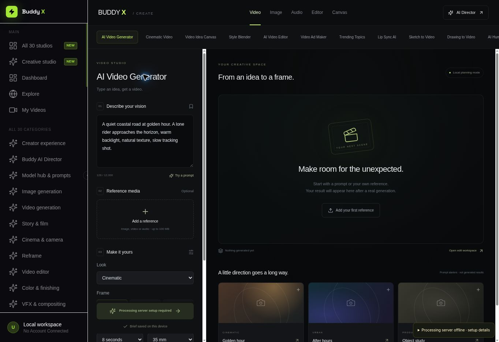
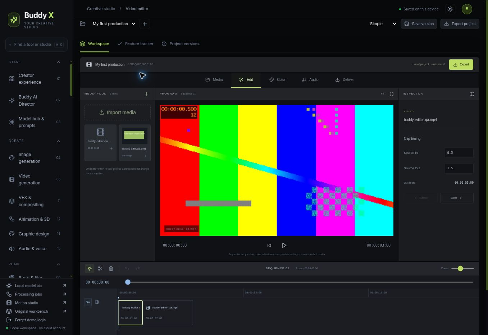
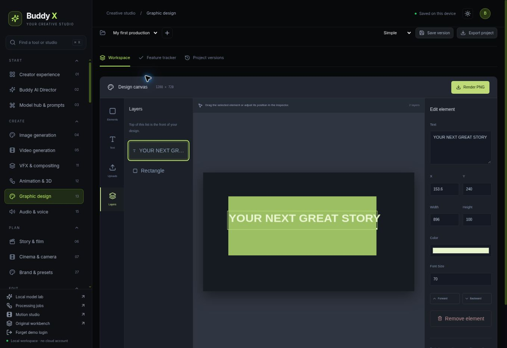

# Browser verification images

These screenshots show the redesigned Buddy X UI in its managed preview. The editor uses a synthetic test clip; the canvas contains a two-layer test design. None is an output from an image/video foundation model. No private YouTube data is included.

The PNG was downloaded through the UI and verified as 1280 × 720. Browser route results are in the frontend public/redesign-route-qa.json.
